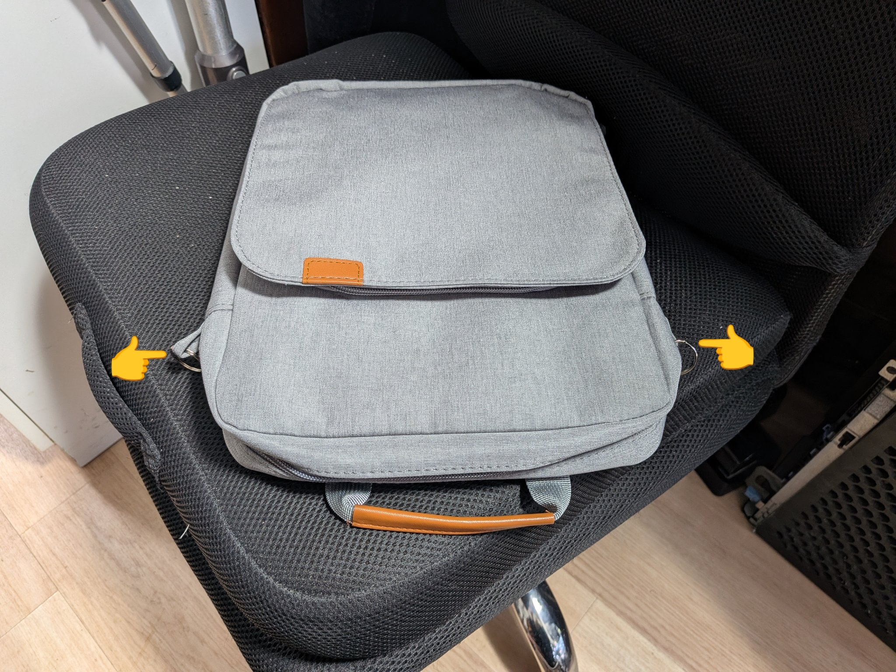
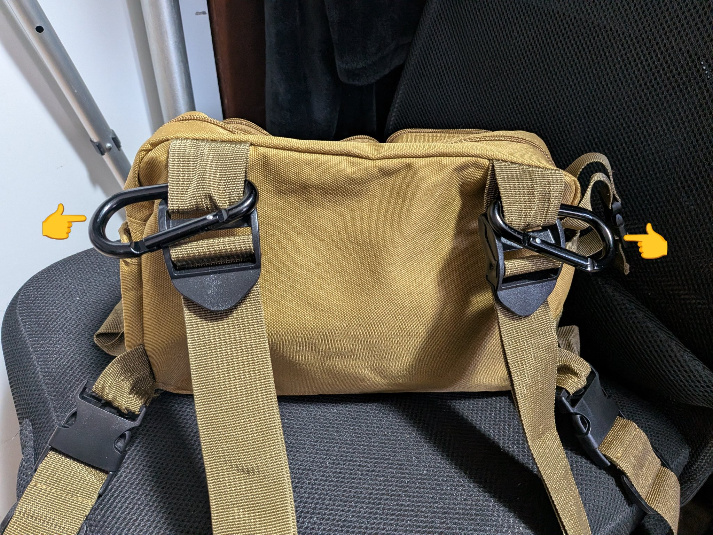
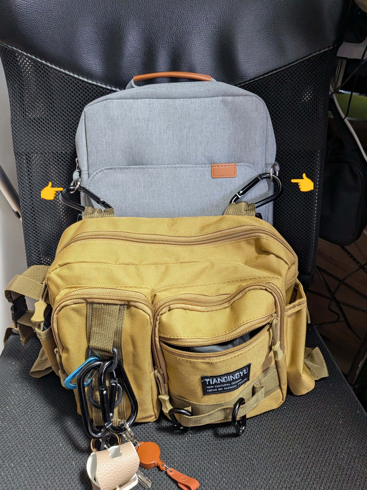
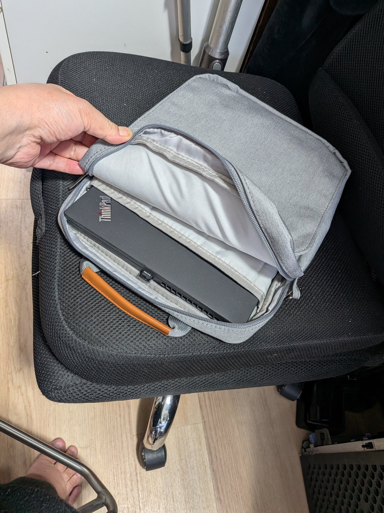
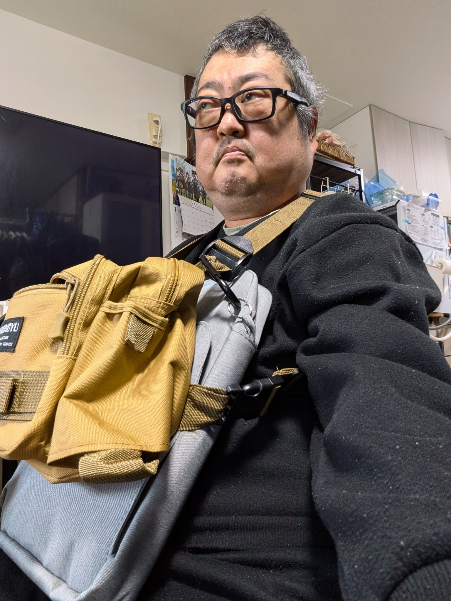

# Royal Monster 13インチ ショルダーバッグ グレー（RM-0924GL）

※この記事にはアフィリエイトリンクが含まれます（楽天市場へのリンクのみ）。

## なぜ必要だったか

ワシの普段の持ち歩きは、胸に付けるチェストバッグが基本だ。車椅子に座ったまま手が届くからだ。ただ今の2連チェストバッグには、13インチのノートPC（Lenovo ThinkPad X13 Gen 2、約305.8×217〜218×18〜19mm）が入らない。

条件はきつい。幅の広いメッセンジャー型は電動車椅子の操作レバーに当たるおそれがあって危ないし、普通のリュックを胸掛けにすると長すぎる。幅も長さもコンパクトで、レバーに干渉しないものが必要だった。

使う場面もはっきりしている。入院用のリュックにはラップトップホルダーがあるので、入院のときはそちらに入れれば済む。困るのは平常時、何かあってもすぐに家へ帰れない場面で、ほぼ通院のときだ。逆に、買い物などの外出でPCを持ち歩くのは重くて決して楽ではないので、その場合はスマホからTailscale経由でTermuxを開き、SSHで入って作業する。

## どう選んだか

ヨドバシ.comで Royal Monster のタブレット用ショルダーバッグ 13インチ グレー（RM-0924GL）を注文。3,880円（ゴールドポイント187円＋クレジットカード3,693円）。色はカートのブラックから本人が意図的にグレーへ変更したもの。

選んだ理由は、縦型で外寸25.0×34.0×4.5cm・約315gとコンパクトで、候補の中で最もレバーから遠い形だったから。ただしこれはタブレット用で、ノートPC対応のメーカー保証はない。あくまで試してみる前提の買い物だった。

なお、価格は店によってだいぶ違う。ワシが買ったヨドバシは3,880円だが、同じ商品は楽天市場やYahoo!ショッピングにも出ていて、楽天（pcastore）では1,738円〜、Yahoo!の公式ストアでは13インチが2,398円だった（いずれも2026-11-08時点）。価格は変動するので、各リンク先で最新を見てほしい。なお、Amazonでは同商品の取り扱いは確認できなかった（2026-11-08時点）。AmazonにはNIDOOなど、よく似た縦型の13インチ用バッグは売られているが、別ブランドの別商品なのでここでは評価しない。

注文は2026-11-03。ヨドバシでは取り寄せ扱いだったため、到着は2026-11-08 11:14（ヨドバシエクストリームサービス便で配達完了）。注文から5日かかった。

## 使ってどうだったか

買ったままでは無理だった。「このままでは無理そう」と、そのままDAISOへ部材調達に行った。買ったのはカラビナ4つ（110円×4＝440円）。

最初は、そのカラビナで成立させた。バッグに付属していたバンドを、元から使っているタン色のチェストバッグの周りに回し、カラビナをバンドのガイドにする感じで留める。Royal Monsterを斜め掛けの土台（ベース層）にして、その上にチェストバッグを重ねる形だ。本人の評価は「行けなくもない」。

その後、もっと良い形が見つかった。バンドを使うのをやめたのだ。バッグの両側にリングを付け（左右1個ずつ）、そこへチェストバッグ側のカラビナ（左右1個ずつ）を直接引っ掛ける。バンドがなくなった分スッキリしたし、脱着が楽になった。今はこの形で使っている。

肝心のThinkPad X13も収まった。写真のとおり、バッグの中にすっぽり入る。タブレット用でノートPC対応のメーカー保証はないが、実際には入った。

出し入れの作法も分かった。装着したままではベルトが邪魔して取り出せない（入れるときも同じ）。だから、作業する場所を決めて、バッグを外してから取り出す、という運用になる。リングとカラビナの直結にしてからは、その脱着自体が楽になった。それで十分だ。要は「X13をいつものチェストバッグと一緒に、電動車椅子のレバーと接触せずに持ち運ぶ」という当初の目的が達成できていればいい。

普段はX13を入れていない「空」の状態で、土台として付けっぱなしにしておく運用もあり得る。必要なときだけX13を入れる。

一番大事な関門はクリアした。車椅子の操作レバー側に干渉しないことを本人が確認済み。

## 購入先リンク

- [楽天市場（pcastore）](https://hb.afl.rakuten.co.jp/ichiba/594407ba.702bad01.594407bb.67ee2c01/_RTLink155077?pc=https%3A%2F%2Fitem.rakuten.co.jp%2Fpcastore%2F10000924%2F&link_type=picttext&ut=eyJwYWdlIjoiaXRlbSIsInR5cGUiOiJwaWN0dGV4dCIsInNpemUiOiIyNDB4MjQwIiwibmFtIjoxLCJuYW1wIjoicmlnaHQiLCJjb20iOjEsImNvbXAiOiJkb3duIiwicHJpY2UiOjEsImJvciI6MSwiY29sIjoxLCJiYnRuIjoxLCJwcm9kIjowLCJhbXAiOmZhbHNlfQ%3D%3D)：1,738円〜（2026-11-08時点）※アフィリエイトリンク
- [ヨドバシ.com](https://www.yodobashi.com/product/100000001008902038/)：3,880円（購入先。当時は取り寄せ。バリエーションで「13インチ グレー」を選択）
- [Yahoo!ショッピング Royal-Monster公式ストア](https://store.shopping.yahoo.co.jp/royal-monster/10000924-13.html)：2,398円・在庫あり（2026-11-08確認）
